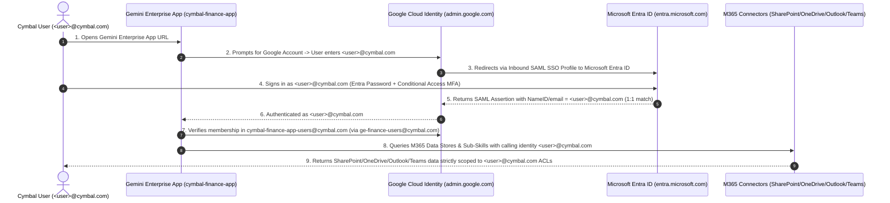

# End-to-End Enterprise Onboarding Guide: **Cymbal (`cymbal.com`)**

This runbook provides the complete, copy-pasteable step-by-step onboarding procedure for **Cymbal** (`cymbal.com`)—including **Microsoft Entra Admin Center (`entra.microsoft.com`)**, **Google Admin Console (`admin.google.com`)**, **Modular Terraform Stacks (01, 02, 03)**, the **Universal ADK Skill & Sub-Skill Orchestrator (`agents-cli`)**, and the **Multi-App AI Skill Hub**.

---

## 1. Cymbal Target Architecture & Onboarding Sequence

```mermaid
flowchart TD
    subgraph P0["Phase 0: Stack 00 — Automated Entra ID & Admin Bootstrap (00-entra-bootstrap)"]
        B0["GCP Project: cymbal-ge-prod<br/>GCS State Bucket: gs://cymbal-ge-tfstate"]
        E0["Automated Entra Bootstrap (deploy_entra_bootstrap.sh)<br/>1. OAuth App (cymbal-ge-m365-connector) + 25+ Graph/SP Scopes + Admin Consent<br/>2. Zero-Touch Secret Sync -> GCP Secret Manager<br/>3. SAML Gallery App (8b1025e4-1dd2-430b-a150-2ef79cd700f5)"]
        G0["Google Admin Console (admin.google.com)<br/>1. Verify Domain: cymbal.com<br/>2. Inbound SAML SSO Profile & OU Assignment"]
    end

    subgraph P1["Phase 1: Stack 01 — Identity & WIF (01-identity-foundation)"]
        ID1["Microsoft Entra ID (cymbal.com)<br/>+ Cloud Identity Inbound SAML SSO"]
        ID2["Entra Security Groups -> Cloud Identity Sync<br/>ge-finance-users@cymbal.com<br/>ge-hr-users@cymbal.com<br/>ge-service-desk-users@cymbal.com<br/>all-ge-apps-users@cymbal.com"]
    end

    subgraph P2["Phase 2: Stack 03 — Shared M365 Connectors (03-m365-connectors)"]
        M1["SharePoint (cymbal-m365-sp)<br/>https://cymbal.sharepoint.com"]
        M2["OneDrive (cymbal-m365-od)<br/>https://cymbal-my.sharepoint.com"]
        M3["Outlook Mail & Calendar (cymbal-m365-ol)"]
        M4["Microsoft Teams (cymbal-m365-teams)"]
    end

    subgraph P3["Phase 3: Stack 02 — Departmental GE Apps (02-ge-app-instance)"]
        A1["cymbal-dev-sandbox-app<br/>(Workspace: app-global-cymbal-dev-sandbox-app)"]
        A2["cymbal-service-desk-app<br/>(Workspace: app-global-cymbal-service-desk-app)"]
        A3["cymbal-finance-app<br/>(Workspace: app-global-cymbal-finance-app)"]
        A4["cymbal-hr-app<br/>(Workspace: app-global-cymbal-hr-app)"]
    end

    subgraph P4["Phase 4 & 5: Universal ADK Orchestrator & Multi-App Skill Hub"]
        O1["Universal ADK Skill & Sub-Skill Orchestrator<br/>(agents-cli deploy -> Vertex AI Agent Engine)"]
        O2["Pinned Assistant in GE Apps (defaultPinned: true)<br/>+ Per-User :streamAssist OAuth Passthrough"]
        O3["6-Stage Skill Governance Pipeline<br/>Dev App -> Eval -> InfoSec -> Registry -> Multi-App Share"]
    end

    P0 --> P1 --> P2 --> P3 --> P4
```



### End-to-End Authentication & 1:1 ACL Enforcement Flow (`cymbal.com`)



### Cymbal Environment Reference Table

| Parameter | Cymbal Production Value |
| :--- | :--- |
| **Customer Name** | `Cymbal` |
| **Corporate Identity Domain** | `cymbal.com` |
| **Initial Entra Tenant Domain** | `cymbal.onmicrosoft.com` |
| **GCP Project ID** | `cymbal-ge-prod` |
| **GCP Region / GE Location** | `us-central1` / `global` |
| **Remote Terraform State Bucket** | `cymbal-ge-tfstate` |
| **Secret Manager M365 Secret** | `cymbal-m365-connector-credentials` |
| **M365 Collection Prefix** | `cymbal-m365` |
| **SharePoint Online URI** | `https://cymbal.sharepoint.com` |
| **OneDrive URI** | `https://cymbal-my.sharepoint.com` |
| **Departmental GE Apps** | `cymbal-dev-sandbox-app`, `cymbal-service-desk-app`, `cymbal-finance-app`, `cymbal-hr-app` |

---

## Phase 0A: Microsoft Entra ID Configuration (`00-entra-bootstrap` or `entra.microsoft.com`)

You must configure **two** objects in Microsoft Entra ID for `cymbal.com`:
1. An **App Registration (OAuth 2.0)** (`cymbal-ge-m365-connector`) with all 25+ Microsoft Graph & SharePoint permissions and Tenant-Wide Admin Consent for the M365 Data Connectors and Microsoft Graph Group Sync.
2. An **Enterprise Application (SAML 2.0)** from the Entra Gallery (`Google Cloud / G Suite Connector by Microsoft`, Template ID `8b1025e4-1dd2-430b-a150-2ef79cd700f5`) to redirect Google Cloud / Gemini Enterprise login to Microsoft Entra ID.

> [!TIP]
> **Full Automation Available (`infra/deploy_entra_bootstrap.sh` & Stack 00):** You do **not** have to click through 25+ API permissions in the Entra Portal manually or copy-paste client secrets! Use **Option A (Terraform `azuread` Stack 00)** or **Option B (Azure CLI + Microsoft Graph REST script)** below to provision everything in ~30 seconds and write `{tenant_id, client_id, client_secret}` directly into Google Cloud Secret Manager (`cymbal-m365-connector-credentials`).

---

### Option A (Recommended): Automated Terraform Stack 00 (`infra/stacks/00-entra-bootstrap`)

Stack 00 ([`infra/stacks/00-entra-bootstrap/main.tf`](../infra/stacks/00-entra-bootstrap/main.tf) + [`infra/modules/entra-bootstrap/main.tf`](../infra/modules/entra-bootstrap/main.tf)) and [`infra/deploy_entra_bootstrap.sh`](../infra/deploy_entra_bootstrap.sh) use `hashicorp/azuread` and `hashicorp/google` to deterministically automate **both Step 0A.1 and Step 0A.2**:
1. **[Step 0A.1]** Creates the OAuth 2.0 App Registration (`cymbal-ge-m365-connector`) with Redirect URI `https://vertexaisearch.cloud.google.com/oauth-redirect`.
2. **[Step 0A.1]** Dynamically resolves all Microsoft Graph (`00000003-0000-0000-c000-000000000000`) and SharePoint Online (`00000003-0000-0ff1-ce00-000000000000`) Role & Scope UUIDs and attaches all **47 Application and Delegated permissions** across SharePoint Online, OneDrive, Outlook, Teams, and Identity Sync.
3. **[Step 0A.1]** Grants **Tenant-Wide Admin Consent** automatically via `azuread_app_role_assignment` and `azuread_service_principal_delegated_permission_grant`.
4. **[Step 0A.1]** Generates a 24-month Client Secret and writes `{tenant_id, client_id, client_secret, domain}` **directly into Google Cloud Secret Manager** (`projects/cymbal-ge-prod/secrets/cymbal-m365-connector-credentials`)—zero human secret handling.
5. **[Step 0A.2]** Pre-creates or resolves the **Google Cloud Identity Inbound SAML SSO Profile** (`CYMBAL Microsoft Entra ID SSO`) when `--cloud-identity-customer-id` is passed, obtaining the exact `SAML_SP_ENTITY_ID` (`https://accounts.google.com/samlrp/<profile_id>`) and `SAML_SP_ACS_URL` (`https://accounts.google.com/samlrp/<profile_id>/acs`) upfront.
6. **[Step 0A.2]** Instantiates the **Google Cloud / G Suite Connector by Microsoft** SAML 2.0 Enterprise Gallery App (`8b1025e4-1dd2-430b-a150-2ef79cd700f5`), sets `preferredSingleSignOnMode = "saml"`, and configures the Identifier (Entity ID) (`azuread_application_identifier_uri`) and Reply URLs (`azuread_application_redirect_uris`).
7. **[Step 0A.2]** Automatically creates Cymbal's **5 Department Security Groups** (`ge-service-desk-users`, `ge-finance-users`, `ge-hr-users`, `ge-skill-developers`, `all-ge-apps-users`) via `azuread_group` and assigns all 5 groups to the SAML Enterprise App (`azuread_app_role_assignment.saml_group_assignments`).
8. **[Step 0A.2]** Generates a SAML X.509 Token-Signing Certificate (`azuread_service_principal_token_signing_certificate`), exports it to `infra/configs/cymbal-entra-saml.cer`, and automatically uploads it into Google Cloud Identity (`inboundSamlSsoProfiles.idpCredentials:add`).

```bash
cd /Users/mohanrajs/aops/geapphub/infra

# 1. Authenticate to Cymbal's Microsoft Entra ID Tenant (Global Admin / Cloud App Admin)
az login --tenant "cymbal.com"

# 2. Authenticate to Google Cloud
gcloud auth application-default login

# 3. Preview Stack 00 (Step 0A.1 + Step 0A.2) in Dry-Run Mode
./deploy_entra_bootstrap.sh \
  --tenant-id "<cymbal-entra-tenant-uuid>" \
  --customer-name "cymbal" \
  --customer-domain "cymbal.com" \
  --gcp-project-id "cymbal-ge-prod" \
  --cloud-identity-customer-id "customers/<CymbalCustomerID>" \
  --mode terraform \
  --dry-run

# 4. Apply Stack 00 (Automates Step 0A.1 OAuth App + Step 0A.2 SAML Gallery App, Groups & Cert Handshake)
./deploy_entra_bootstrap.sh \
  --tenant-id "<cymbal-entra-tenant-uuid>" \
  --customer-name "cymbal" \
  --customer-domain "cymbal.com" \
  --gcp-project-id "cymbal-ge-prod" \
  --cloud-identity-customer-id "customers/<CymbalCustomerID>" \
  --mode terraform
```

---

### Option B: Automated Azure CLI + Microsoft Graph API Script (`--mode az-graph`)

If Cymbal's Entra administrator prefers running an imperative CLI script without Terraform state, run `deploy_entra_bootstrap.sh` with `--mode az-graph` (automates all 8 steps of Step 0A.1 and Step 0A.2 via Microsoft Graph REST API v1.0):

```bash
cd /Users/mohanrajs/aops/geapphub/infra

./deploy_entra_bootstrap.sh \
  --tenant-id "<cymbal-entra-tenant-uuid>" \
  --customer-name "cymbal" \
  --customer-domain "cymbal.com" \
  --gcp-project-id "cymbal-ge-prod" \
  --cloud-identity-customer-id "customers/<CymbalCustomerID>" \
  --mode az-graph
```

---

### Step 0A.1: Create the OAuth 2.0 App Registration (`cymbal-ge-m365-connector`) — Automated & Manual Options

#### Option 0A.1-A (Recommended): Automated via Terraform (`--mode terraform`) or Azure CLI (`--mode az-graph`)
Running `./deploy_entra_bootstrap.sh` automatically provisions both **Step 0A.1** (OAuth App + 47 Permissions + Admin Consent + Secret Manager sync) and **Step 0A.2** (SAML Gallery App + 5 Department Security Groups + Cloud Identity Certificate Handshake):

```bash
cd /Users/mohanrajs/aops/geapphub/infra

# 1. Authenticate to Cymbal's Microsoft Entra ID Tenant & Google Cloud
az login --tenant "cymbal.com"
gcloud auth application-default login

# 2. Run Terraform Mode (or pass --mode az-graph for Azure CLI / Graph REST mode)
./deploy_entra_bootstrap.sh \
  --tenant-id "<cymbal-entra-tenant-uuid>" \
  --customer-name "cymbal" \
  --customer-domain "cymbal.com" \
  --gcp-project-id "cymbal-ge-prod" \
  --cloud-identity-customer-id "customers/<CymbalCustomerID>" \
  --mode terraform
```

#### Option 0A.1-B: Manual `entra.microsoft.com` Portal UI Reference (Step 0A.1)
If Cymbal's identity team requires manual UI execution for Step 0A.1 instead of running `deploy_entra_bootstrap.sh`:
1. Sign in to **[entra.microsoft.com](https://entra.microsoft.com)** as a Global Administrator or Cloud Application Administrator for `cymbal.com`.
2. Navigate to **Identity -> Applications -> App registrations -> + New registration**:
   - **Name:** `cymbal-ge-m365-connector`
   - **Supported account types:** *Accounts in this organizational directory only (Cymbal only - Single tenant)*
   - **Redirect URI:** Select **Web** and enter the exact Discovery Engine OAuth callback URL:
     ```text
     https://vertexaisearch.cloud.google.com/oauth-redirect
     ```
   - Click **Register** and copy:
     - **Application (client) ID** $\rightarrow$ `M365_CLIENT_ID`
     - **Directory (tenant) ID** $\rightarrow$ `M365_TENANT_ID`
3. Navigate to **Certificates & secrets -> Client secrets -> + New client secret**:
   - **Description:** `Gemini Enterprise M365 Connector & Graph Sync`
   - **Expires:** `24 months` (or per Cymbal security policy)
   - Click **Add** and immediately copy the secret **Value** (not the Secret ID) $\rightarrow$ `M365_CLIENT_SECRET`.
4. Navigate to **API permissions -> + Add a permission** and add the following **47 Application and Delegated permissions** (automatically attached by Stack 00):

   ##### 1. Microsoft Graph — Application Permissions (`12 Roles` — *for Entra Group Sync & Connector Ingestion across all 4 M365 Apps*)
   | M365 Application | Permission (`Role`) | Purpose |
   | :--- | :--- | :--- |
   | **Entra -> Cloud Identity Sync** | `User.Read.All`, `Group.Read.All`, `GroupMember.Read.All` | Read `@cymbal.com` users, `ge-*@cymbal.com` groups & transitive memberships |
   | **SharePoint Online (`m365-sp`) & OneDrive (`m365-od`)** | `Sites.Read.All`, `Files.Read.All` | SharePoint site metadata & OneDrive/SharePoint file ACL indexing |
   | **Outlook (`m365-ol`)** | `Mail.Read`, `Calendars.Read`, `Contacts.Read` | Exchange Online Mail, Calendar & Contact ingestion metadata |
   | **Microsoft Teams (`m365-teams`)** | `Team.ReadBasic.All`, `Channel.ReadBasic.All`, `ChannelMessage.Read.All`, `Chat.Read.All` | Teams, Channel & Chat metadata indexing |

   ##### 2. Microsoft Graph — Delegated Permissions (`29 Scopes` — *for End-User 3-Legged OAuth, Federated Search & 46 Write Actions across all 4 M365 Apps*)
   | M365 Application | Delegated Permissions (`Scope`) | Supported Entities & Write Actions |
   | :--- | :--- | :--- |
   | **OpenID & Core Profile** | `openid`, `profile`, `email`, `offline_access`, `User.Read`, `People.Read` | OIDC Sign-In, Refresh Tokens & User Context |
   | **SharePoint Online (`m365-sp`) & OneDrive (`m365-od`)** | `Files.Read.All`, `Files.ReadWrite.All`, `Sites.Read.All`, `Sites.ReadWrite.All`, `Sites.Manage.All` | **Entities:** `file`, `page`<br/>**18 SharePoint Actions:** `create_folder`, `add_page`, `upload_document`, `add_list`, `list_lists`, `get_list_item`, `get_list_fields`, `check_in_document`, `check_out_document`, `discard_check_out_document`, `move_attachment_or_document`, `rename_attachment_or_document`, `update_file_properties`, `create_list_item`, `update_list_item`, `update_list`, `update_page`, `share_resource`<br/>**10 OneDrive Actions:** `upload_file`, `copy_file`, `copy_folder`, `move_file`, `move_folder`, `create_folder`, `rename_file`, `rename_folder`, `share_file_folder`, `update_file_properties` |
   | **Outlook Mail, Calendar & Contacts (`m365-ol`)** | `Mail.Read`, `Mail.ReadWrite`, `Mail.ReadWrite.Shared`, `Mail.Send`, `Mail.Send.Shared`, `Calendars.Read`, `Calendars.ReadWrite`, `Calendars.Read.Shared`, `Contacts.Read`, `Contacts.ReadWrite`, `Contacts.ReadWrite.Shared`, `MailboxSettings.Read` | **Entities:** `mail`, `mail-attachment`, `calendar`, `contact`<br/>**15 Outlook Actions:** `send_mail`, `create_message`, `update_message`, `reply_to_my_message`, `forward_mail`, `move_mail`, `add_attachments`, `download_attachments`, `create_event`, `update_event`, `rsvp_to_event`, `create_calendar`, `update_calendar`, `create_contact`, `update_contact` |
   | **Microsoft Teams (`m365-teams`)** | `Chat.Read`, `Chat.ReadWrite`, `ChatMessage.Send`, `ChannelMessage.Read.All`, `ChannelMessage.Send`, `Team.ReadBasic.All`, `Channel.ReadBasic.All`, `Channel.Create` | **Entities:** `channel-message`, `chat-message`<br/>**3 Teams Actions:** `send_channel_message`, `send_chat_message`, `create_channel` |

   ##### 3. SharePoint (`Office 365 SharePoint Online`) — Application & Delegated Permissions (`6 Permissions` — *for Federated Search & Lists/Pages*)
   | Permission | Type | Purpose |
   | :--- | :--- | :--- |
   | `Sites.Read.All` | Application (`Role`) | Background site collection discovery across `https://cymbal.sharepoint.com` |
   | `AllSites.Read`, `AllSites.Write`, `AllSites.Manage` | Delegated (`Scope`) | Federated search & list/page write actions across `https://cymbal.sharepoint.com` |
   | `MyFiles.Read`, `MyFiles.Write` | Delegated (`Scope`) | Federated search & file write actions across `https://cymbal-my.sharepoint.com` |

5. Click **"Grant admin consent for Cymbal"** at the top of the **API permissions** table and click **Yes** until every permission row shows a green **"Granted for Cymbal"** badge.

---

### Step 0A.2: Create & Configure the SAML 2.0 Enterprise Gallery App (`Google Cloud / G Suite Connector by Microsoft`) — Automated & Manual Options

> [!WARNING]
> Do **not** use the OAuth App Registration from Step 0A.1 for SAML SSO (the SAML tile is disabled on standard App Registrations). Always instantiate the official gallery application **`Google Cloud / G Suite Connector by Microsoft`** (`Template ID: 8b1025e4-1dd2-430b-a150-2ef79cd700f5`) under **Enterprise applications**.

#### Option 0A.2-A (Recommended): Automated via Terraform (`infra/modules/entra-bootstrap/main.tf`)
When you run `./deploy_entra_bootstrap.sh --mode terraform` (or apply [`infra/stacks/00-entra-bootstrap/main.tf`](../infra/stacks/00-entra-bootstrap/main.tf)), Terraform and the orchestrator script automatically execute every part of **Step 0A.2**:
1. **Pre-Resolves Cloud Identity SAML Service Provider URLs:** Calls `https://cloudidentity.googleapis.com/v1/inboundSamlSsoProfiles` to create/fetch Cymbal's `SAML_SP_ENTITY_ID` (`https://accounts.google.com/samlrp/<profile_id>`) and `SAML_SP_ACS_URL` (`https://accounts.google.com/samlrp/<profile_id>/acs`).
2. **Instantiates the Gallery SAML App (`azuread_application_from_template.google_cloud_saml`):** Instantiates Template `8b1025e4-1dd2-430b-a150-2ef79cd700f5` as **`CYMBAL Google Cloud & Gemini Enterprise SSO`**.
3. **Configures SAML Entity ID & ACS Reply URLs (`azuread_application_identifier_uri` & `azuread_application_redirect_uris`):** Configures `https://accounts.google.com/samlrp/<profile_id>` and `https://accounts.google.com/samlrp/<profile_id>/acs` (plus `https://www.google.com/a/cymbal.com/acs`).
4. **Creates & Assigns All 5 Cymbal Department Security Groups (`azuread_group.department_groups` & `azuread_app_role_assignment.saml_group_assignments`):** Creates `ge-service-desk-users`, `ge-finance-users`, `ge-hr-users`, `ge-skill-developers`, and `all-ge-apps-users` in Entra ID and assigns all 5 groups to the SAML Enterprise App (`appRoleId = 00000000-0000-0000-0000-000000000000`).
5. **Generates & Uploads the SAML X.509 Signing Certificate (`azuread_service_principal_token_signing_certificate.saml_cert`):** Generates the SAML signing certificate, exports `infra/configs/cymbal-entra-saml.cer`, and automatically uploads it into Google Cloud Identity (`POST .../idpCredentials:add`).

#### Option 0A.2-B: Automated Standalone Azure CLI + Microsoft Graph Script (Step 0A.2 Only)
If you already created the OAuth App in Step 0A.1 and want to automate **Step 0A.2** directly using Azure CLI (`az rest`) and `gcloud`, run this copy-pasteable block:

```bash
export ENTRA_TENANT_ID="<cymbal-entra-tenant-uuid>"
export CUSTOMER_NAME="cymbal"
export CUSTOMER_DOMAIN="cymbal.com"
export GCP_PROJECT_ID="cymbal-ge-prod"
export CLOUD_IDENTITY_CUSTOMER_ID="customers/<CymbalCustomerID>"
export GALLERY_TEMPLATE_ID="8b1025e4-1dd2-430b-a150-2ef79cd700f5"
export SAML_APP_NAME="CYMBAL Google Cloud & Gemini Enterprise SSO"

# 1. Pre-create / fetch Cloud Identity Inbound SAML SSO Profile to obtain SP Entity ID & ACS URL
GCP_TOKEN="$(gcloud auth print-access-token)"
CREATE_SSO_RESP="$(curl -sS -X POST "https://cloudidentity.googleapis.com/v1/inboundSamlSsoProfiles" \
  -H "Authorization: Bearer ${GCP_TOKEN}" \
  -H "x-goog-user-project: ${GCP_PROJECT_ID}" \
  -H "Content-Type: application/json" \
  -d "{
    \"customer\": \"${CLOUD_IDENTITY_CUSTOMER_ID}\",
    \"displayName\": \"CYMBAL Microsoft Entra ID SSO\",
    \"idpConfig\": {
      \"entityId\": \"https://sts.windows.net/${ENTRA_TENANT_ID}/\",
      \"singleSignOnServiceUri\": \"https://login.microsoftonline.com/${ENTRA_TENANT_ID}/saml2\"
    }
  }")"

SAML_PROFILE_NAME="$(echo "${CREATE_SSO_RESP}" | jq -r '.response.name // .name')"
SAML_SP_ENTITY_ID="$(echo "${CREATE_SSO_RESP}" | jq -r '.response.spConfig.entityId // .spConfig.entityId')"
SAML_SP_ACS_URL="$(echo "${CREATE_SSO_RESP}" | jq -r '.response.spConfig.assertionConsumerServiceUri // .spConfig.assertionConsumerServiceUri')"

# 2. Instantiate "Google Cloud / G Suite Connector by Microsoft" from the Entra Gallery
SAML_INSTANTIATE_JSON="$(az rest \
  --method POST \
  --uri "https://graph.microsoft.com/v1.0/applicationTemplates/${GALLERY_TEMPLATE_ID}/instantiate" \
  --headers "Content-Type=application/json" \
  --body "{\"displayName\": \"${SAML_APP_NAME}\"}")"

SAML_SP_ID="$(echo "${SAML_INSTANTIATE_JSON}" | jq -r '.servicePrincipal.id')"
SAML_APP_ID="$(echo "${SAML_INSTANTIATE_JSON}" | jq -r '.application.id')"

# 3. Configure SAML Mode, Identifier (Entity ID), Reply URL (ACS URL) & Sign-on URL
az rest \
  --method PATCH \
  --uri "https://graph.microsoft.com/v1.0/applications/${SAML_APP_ID}" \
  --headers "Content-Type=application/json" \
  --body "{
    \"identifierUris\": [\"${SAML_SP_ENTITY_ID}\", \"https://www.google.com/a/${CUSTOMER_DOMAIN}\"],
    \"web\": {
      \"redirectUris\": [\"${SAML_SP_ACS_URL}\", \"https://www.google.com/a/${CUSTOMER_DOMAIN}/acs\", \"https://www.google.com\"]
    }
  }"

az rest \
  --method PATCH \
  --uri "https://graph.microsoft.com/v1.0/servicePrincipals/${SAML_SP_ID}" \
  --headers "Content-Type=application/json" \
  --body "{
    \"preferredSingleSignOnMode\": \"saml\",
    \"loginUrl\": \"https://www.google.com/a/${CUSTOMER_DOMAIN}/ServiceLogin?continue=https://vertexaisearch.cloud.google.com\",
    \"appRoleAssignmentRequired\": true
  }"

# 4. Create & Assign Cymbal's 5 Department Security Groups to the SAML Enterprise App
for grp_nick in ge-service-desk-users ge-finance-users ge-hr-users ge-skill-developers all-ge-apps-users; do
  GRP_ID="$(az ad group list --filter "mailNickname eq '${grp_nick}'" --query "[0].id" -o tsv)"
  if [[ -z "${GRP_ID}" ]]; then
    GRP_ID="$(az ad group create --display-name "CYMBAL ${grp_nick}" --mail-nickname "${grp_nick}" --query "id" -o tsv)"
  fi
  az rest \
    --method POST \
    --uri "https://graph.microsoft.com/v1.0/servicePrincipals/${SAML_SP_ID}/appRoleAssignedTo" \
    --headers "Content-Type=application/json" \
    --body "{\"principalId\": \"${GRP_ID}\", \"resourceId\": \"${SAML_SP_ID}\", \"appRoleId\": \"00000000-0000-0000-0000-000000000000\"}"
done

# 5. Generate SAML X.509 Token-Signing Certificate & Upload Directly to Google Cloud Identity
CERT_JSON="$(az rest \
  --method POST \
  --uri "https://graph.microsoft.com/v1.0/servicePrincipals/${SAML_SP_ID}/addTokenSigningCertificate" \
  --headers "Content-Type=application/json" \
  --body "{\"displayName\": \"CN=cymbal Google Cloud SAML Signing\"}")"

CERT_PEM="-----BEGIN CERTIFICATE-----\n$(echo "${CERT_JSON}" | jq -r '.key')\n-----END CERTIFICATE-----"
curl -sS -X POST "https://cloudidentity.googleapis.com/v1/${SAML_PROFILE_NAME}/idpCredentials:add" \
  -H "Authorization: Bearer ${GCP_TOKEN}" \
  -H "x-goog-user-project: ${GCP_PROJECT_ID}" \
  -H "Content-Type: application/json" \
  -d "$(jq -n --arg pem "$(printf '%b' "${CERT_PEM}")" '{pemData: $pem}')"
```

#### Option 0A.2-C: Manual `entra.microsoft.com` Portal UI Reference (Step 0A.2)
If Cymbal's identity team prefers manual UI clicks instead of Option 0A.2-A or Option 0A.2-B:
1. In **[entra.microsoft.com](https://entra.microsoft.com)**, navigate to **Identity -> Applications -> Enterprise applications -> + New application**.
2. In the gallery search box, type:
   ```text
   Google Cloud / G Suite Connector by Microsoft
   ```
3. Select the tile, name it **`Cymbal Google Cloud & Gemini Enterprise SSO`**, and click **Create**.
4. Navigate to **Manage -> Users and groups -> + Add user/group** and assign Cymbal's department security groups:
   - `ge-service-desk-users@cymbal.com`
   - `ge-finance-users@cymbal.com`
   - `ge-hr-users@cymbal.com`
   - `ge-skill-developers@cymbal.com`
   - `all-ge-apps-users@cymbal.com`
5. Navigate to **Manage -> Single sign-on** and select **SAML**:
   - Paste `https://accounts.google.com/samlrp/<profile_id>` into **Identifier (Entity ID)** and `https://accounts.google.com/samlrp/<profile_id>/acs` into **Reply URL (ACS URL)**.

---

## Phase 0B: Google Admin Console & Cloud Identity Configuration (`deploy_google_admin_bootstrap.sh` or `admin.google.com`)

> [!TIP]
> **Full Automation Available (`infra/deploy_google_admin_bootstrap.sh`):** You do **not** have to manually log into `admin.google.com` to look up Cymbal's Customer ID, copy-paste DNS TXT verification tokens, or assign the SAML SSO profile! Run [`infra/deploy_google_admin_bootstrap.sh`](../infra/deploy_google_admin_bootstrap.sh) (Option 0B-A below) to auto-discover `CLOUD_IDENTITY_CUSTOMER_ID`, `GCP_ORG_ID`, and `SAML_TARGET_ORG_UNIT`, automatically register and verify `cymbal.com` via the Google Site Verification API + Cloud DNS, verify Admin API readiness, assign the Inbound SAML SSO Profile to Cymbal's Root Organizational Unit, and auto-generate `infra/configs/cymbal-identity.env`.

---

### Option 0B-A (Recommended): 1-Command Automated Google Admin & Domain Bootstrap (`deploy_google_admin_bootstrap.sh`)

[`infra/deploy_google_admin_bootstrap.sh`](../infra/deploy_google_admin_bootstrap.sh) automates both **Step 0B.1** and **Step 0B.2** in a single command:
1. **[Step 0B.1a — Auto-Discovery]** Queries `gcloud organizations list` and Admin SDK Directory API (`GET /admin/directory/v1/customers/my_customer` & `/orgunits`) to automatically resolve:
   - `GCP_ORG_ID` (`organizations/<id>`)
   - `CLOUD_IDENTITY_CUSTOMER_ID` (`customers/C0xxxxxxx`)
   - `SAML_TARGET_ORG_UNIT` (`orgUnits/03ph8a2z...`)
2. **[Step 0B.1b — Automated Domain Registration, Cloud DNS TXT & Site Verification]**
   - Checks/registers `cymbal.com` in Google Admin Directory API (`POST /admin/directory/v1/customer/my_customer/domains`).
   - Requests the `google-site-verification=...` token via Google Site Verification API (`POST https://www.googleapis.com/siteVerification/v1/token`).
   - Automatically provisions the `@ TXT "google-site-verification=..."` record in Cloud DNS (`--dns-zone-name "cymbal-com-zone"`) and triggers `POST https://www.googleapis.com/siteVerification/v1/webResource?verificationMethod=DNS_TXT` to mark `cymbal.com` as **Verified** in `admin.google.com`.
3. **[Step 0B.2 — Admin API Verification, SAML Profile Assignment & Config Generation]**
   - Enables `admin.googleapis.com`, `cloudidentity.googleapis.com`, `siteverification.googleapis.com`, and `dns.googleapis.com`.
   - Verifies Cloud Identity Groups API readiness (`HTTP 200`).
   - Creates/updates the **Cloud Identity Inbound SAML SSO Profile** (`CYMBAL Microsoft Entra ID SSO`), uploads `infra/configs/cymbal-entra-saml.cer`, and assigns SAML SSO to Cymbal's Root Organizational Unit (`POST https://cloudidentity.googleapis.com/v1/inboundSsoAssignments`).
   - Auto-generates `infra/configs/cymbal-identity.env` ready for Phase 1.

```bash
cd /Users/mohanrajs/aops/geapphub/infra

# 1. Authenticate with Super Admin / GCP Organization Admin credentials
gcloud auth login admin@cymbal.com
gcloud auth application-default login

# 2. Preview Phase 0B in Dry-Run Mode
./deploy_google_admin_bootstrap.sh \
  --customer-name "cymbal" \
  --customer-domain "cymbal.com" \
  --gcp-project-id "cymbal-ge-prod" \
  --entra-tenant-id "<cymbal-entra-tenant-uuid>" \
  --dns-zone-name "cymbal-com-zone" \
  --dry-run

# 3. Execute Phase 0B Automation
./deploy_google_admin_bootstrap.sh \
  --customer-name "cymbal" \
  --customer-domain "cymbal.com" \
  --gcp-project-id "cymbal-ge-prod" \
  --entra-tenant-id "<cymbal-entra-tenant-uuid>" \
  --dns-zone-name "cymbal-com-zone"
```

---

### Option 0B-B: Standalone CLI / REST API Commands for Step 0B.1 & Step 0B.2

If you want to run each Phase 0B sub-step individually via `gcloud` and `curl`:

#### Step 0B.1 (Automated CLI): Auto-Discover Customer ID & Verify `cymbal.com` via Site Verification API
```bash
export CLOUDSDK_METRICS_ENVIRONMENT=geapphub
export GCP_PROJECT_ID="cymbal-ge-prod"
export CUSTOMER_DOMAIN="cymbal.com"
export DNS_ZONE_NAME="cymbal-com-zone"

# 1. Enable Admin SDK, Cloud Identity, Site Verification & Cloud DNS APIs
gcloud services enable \
  admin.googleapis.com \
  cloudidentity.googleapis.com \
  siteverification.googleapis.com \
  dns.googleapis.com \
  --project="${GCP_PROJECT_ID}"

GCP_TOKEN="$(gcloud auth print-access-token)"

# 2. Auto-discover GCP_ORG_ID & CLOUD_IDENTITY_CUSTOMER_ID (customers/C0xxxxxxx)
read -r GCP_ORG_ID DIRECTORY_CUSTOMER_ID < <(
  gcloud organizations list \
    --filter="displayName:${CUSTOMER_DOMAIN}" \
    --format="value(name.basename(),owner.directoryCustomerId)"
)
export CLOUD_IDENTITY_CUSTOMER_ID="customers/${DIRECTORY_CUSTOMER_ID}"
echo "Discovered GCP_ORG_ID=${GCP_ORG_ID}, CLOUD_IDENTITY_CUSTOMER_ID=${CLOUD_IDENTITY_CUSTOMER_ID}"

# 3. Register cymbal.com in Google Admin Directory (idempotent if already primary/secondary domain)
curl -sS -X POST "https://admin.googleapis.com/admin/directory/v1/customer/${DIRECTORY_CUSTOMER_ID}/domains" \
  -H "Authorization: Bearer ${GCP_TOKEN}" \
  -H "x-goog-user-project: ${GCP_PROJECT_ID}" \
  -H "Content-Type: application/json" \
  -d "{\"domainName\": \"${CUSTOMER_DOMAIN}\"}"

# 4. Request DNS_TXT Verification Token via Google Site Verification API
VERIFY_TOKEN="$(curl -sS -X POST "https://www.googleapis.com/siteVerification/v1/token" \
  -H "Authorization: Bearer ${GCP_TOKEN}" \
  -H "x-goog-user-project: ${GCP_PROJECT_ID}" \
  -H "Content-Type: application/json" \
  -d "{
    \"site\": {\"type\": \"INET_DOMAIN\", \"identifier\": \"${CUSTOMER_DOMAIN}\"},
    \"verificationMethod\": \"DNS_TXT\"
  }" | jq -r '.token')"

# 5. Provision TXT Verification Record in Cloud DNS & Trigger Verification
gcloud dns record-sets create "${CUSTOMER_DOMAIN}." \
  --project="${GCP_PROJECT_ID}" \
  --zone="${DNS_ZONE_NAME}" \
  --type="TXT" \
  --ttl="60" \
  --rrdatas="\"${VERIFY_TOKEN}\""

curl -sS -X POST "https://www.googleapis.com/siteVerification/v1/webResource?verificationMethod=DNS_TXT" \
  -H "Authorization: Bearer ${GCP_TOKEN}" \
  -H "x-goog-user-project: ${GCP_PROJECT_ID}" \
  -H "Content-Type: application/json" \
  -d "{\"site\": {\"type\": \"INET_DOMAIN\", \"identifier\": \"${CUSTOMER_DOMAIN}\"}}"
```

#### Step 0B.2 (Automated CLI): Verify Admin API Access & Assign SAML SSO to Root Org Unit
```bash
# 1. Verify Cloud Identity Groups API & Admin SDK Directory API access
curl -sS -H "Authorization: Bearer ${GCP_TOKEN}" \
  -H "x-goog-user-project: ${GCP_PROJECT_ID}" \
  "https://cloudidentity.googleapis.com/v1/groups?parent=${CLOUD_IDENTITY_CUSTOMER_ID}" | jq .

# 2. Auto-discover Cymbal's Root Organizational Unit ID (orgUnits/...)
ROOT_OU_ID="$(curl -sS -H "Authorization: Bearer ${GCP_TOKEN}" \
  -H "x-goog-user-project: ${GCP_PROJECT_ID}" \
  "https://admin.googleapis.com/admin/directory/v1/customer/${DIRECTORY_CUSTOMER_ID}/orgunits?type=all" \
  | jq -r '.organizationUnits[] | select(.parentOrgUnitPath == "/" or .orgUnitPath == "/") | .orgUnitId | sub("^id:"; "orgUnits/")' | head -n 1)"

echo "Discovered Root Org Unit: ${ROOT_OU_ID}"
```

---

### Option 0B-C: Manual `admin.google.com` Portal UI Reference (Fallback)

If Cymbal's Google Workspace / Cloud Identity Super Admin prefers manual UI verification in **[Google Admin Console (`admin.google.com`)](https://admin.google.com)**:

#### Step 0B.1 (Manual UI): Retrieve Cymbal's Cloud Identity Customer ID & Verify `cymbal.com`
1. Sign in to **[Google Admin Console (`admin.google.com`)](https://admin.google.com)** as a Super Admin (`admin@cymbal.com`).
2. **Copy the Customer ID:**
   - Navigate to **Account -> Account settings -> Profile**.
   - Copy the **Customer ID** (e.g., `C01234567`) and prefix it with `customers/` $\rightarrow$ `CLOUD_IDENTITY_CUSTOMER_ID="customers/C01234567"`.
3. **Verify Corporate Domain (`cymbal.com`):**
   - Navigate to **Account -> Domains -> Manage domains**.
   - Ensure `cymbal.com` shows **Verified** (Primary or Secondary domain).
   - If `cymbal.com` is not yet verified, click **Add a domain**, enter `cymbal.com`, choose **TXT verification record**, copy the `google-site-verification=...` token, add it to Cymbal's DNS zone (or set `MANAGE_DNS_VERIFICATION_RECORD="true"` in `configs/cymbal-identity.env`), and click **Verify**.

#### Step 0B.2 (Manual UI): Enable Admin API Access for Automated Group & User Sync
1. In **[admin.google.com](https://admin.google.com)**, navigate to **Security -> Access and data control -> API controls**.
2. Ensure **Enable API access** is checked so Cloud Identity Groups API and Admin SDK Directory API calls from Stack 01 succeed.

---

## Phase 0C: GCP Project, APIs & Remote Terraform State Bucket (`cymbal-ge-prod`)

Run these commands once to prepare Cymbal's GCP project (`cymbal-ge-prod`) and create the versioned GCS bucket (`gs://cymbal-ge-tfstate`) used for isolated per-stack and per-app Terraform state locking.

```bash
export CLOUDSDK_METRICS_ENVIRONMENT=geapphub
export GCP_PROJECT_ID="cymbal-ge-prod"
export GCP_REGION="us-central1"
export TF_STATE_BUCKET="cymbal-ge-tfstate"

# 1. Set active project
gcloud config set project "${GCP_PROJECT_ID}"

# 2. Enable required Google Cloud APIs
gcloud services enable \
  discoveryengine.googleapis.com \
  cloudidentity.googleapis.com \
  admin.googleapis.com \
  secretmanager.googleapis.com \
  aiplatform.googleapis.com \
  agentregistry.googleapis.com \
  iam.googleapis.com \
  iamcredentials.googleapis.com \
  sts.googleapis.com \
  storage.googleapis.com \
  bigquery.googleapis.com

# 3. Create the remote Terraform state bucket with Object Versioning enabled
gcloud storage buckets create "gs://${TF_STATE_BUCKET}" \
  --project="${GCP_PROJECT_ID}" \
  --location="${GCP_REGION}" \
  --uniform-bucket-level-access

gcloud storage buckets update "gs://${TF_STATE_BUCKET}" --versioning
```

---

## Phase 1: Identity Foundation (`cymbal.com`) & Completing the SAML Handshake — Stack 01

Stack 01 (`infra/stacks/01-identity-foundation` & `infra/deploy_identity.sh`) automates:
1. **Google Cloud Secret Manager** secret (`cymbal-m365-connector-credentials`) with Cymbal's Entra ID Tenant/Client credentials.
2. **Cloud Identity Inbound SAML 2.0 SSO Profile** (`Cymbal Microsoft Entra ID SSO`) for `cymbal.com`.
3. **Entra ID -> Cloud Identity Group & Membership Sync** for `startswith(mailNickname,'ge-')`, nesting each Entra group 1:1 into its corresponding Gemini Enterprise App access group.

> [!IMPORTANT]
> **Zero-Disk Secret Injection:** Never write `M365_CLIENT_SECRET` to a `.env` file on disk. Export it in your shell session (or pass it through the AppHub Provisioning Studio UI, which injects `TF_VAR_m365_client_secret` in memory and redacts it from all logs).

### Step 1.1: Validate Entra Credentials & Run `deploy_identity.sh`

```bash
cd /Users/mohanrajs/aops/geapphub/infra

# 1. Export Entra ID credentials in memory (from Phase 0A.1)
export M365_TENANT_ID="<cymbal-entra-tenant-uuid>"
export M365_CLIENT_ID="<cymbal-entra-app-client-uuid>"
export M365_CLIENT_SECRET="<cymbal-entra-app-client-secret>"

# 2. Verify OAuth2 client_credentials handshake against Microsoft Identity Platform
curl -sS -X POST "https://login.microsoftonline.com/${M365_TENANT_ID}/oauth2/v2.0/token" \
  -H "Content-Type: application/x-www-form-urlencoded" \
  --data-urlencode "client_id=${M365_CLIENT_ID}" \
  --data-urlencode "client_secret=${M365_CLIENT_SECRET}" \
  --data-urlencode "scope=https://graph.microsoft.com/.default" \
  --data-urlencode "grant_type=client_credentials" \
  | jq -e '.access_token != null' >/dev/null \
  && echo "[OK] Cymbal Microsoft Entra ID credentials validated"

# 3. Create Cymbal's identity configuration file
cat > configs/cymbal-identity.env <<'EOF'
GCP_PROJECT_ID="cymbal-ge-prod"
GCP_REGION="us-central1"
GCP_ORG_ID="<cymbal-gcp-org-id>"
GE_LOCATION="global"

CLOUD_IDENTITY_CUSTOMER_ID="customers/<CymbalCustomerID>"
PRIMARY_CUSTOMER_DOMAIN="cymbal.com"
SHARED_IDENTITY_DOMAIN="cymbal.com"
ENTRA_SOURCE_DOMAIN="cymbal.onmicrosoft.com"

TF_STATE_BUCKET="cymbal-ge-tfstate"
TF_STATE_PREFIX="ge-apphub/01-identity-foundation/id-cymbal-com"

M365_SECRET_ID="cymbal-m365-connector-credentials"
ENTRA_GROUP_FILTER="startswith(mailNickname,'ge-')"
ENTRA_TO_APP_GROUP_MAPPINGS="ge-service-desk-users@cymbal.com:cymbal-service-desk-app-users@cymbal.com,ge-finance-users@cymbal.com:cymbal-finance-app-users@cymbal.com,ge-hr-users@cymbal.com:cymbal-hr-app-users@cymbal.com"

ENABLE_CLOUD_IDENTITY_SAML_SSO="true"
SAML_SSO_PROFILE_DISPLAY_NAME="Cymbal Microsoft Entra ID SSO"
ENABLE_WORKFORCE_POOL_OIDC="false"
WORKFORCE_POOL_ID="cymbal-entra-wif-pool"
WORKFORCE_PROVIDER_ID="cymbal-entra-oidc-provider"
EOF

# 4. Run Dry-Run / Plan first (Workspace isolated to id-cymbal-com)
TF_WORKSPACE_OVERRIDE="id-cymbal-com" ./deploy_identity.sh \
  --config configs/cymbal-identity.env \
  --dry-run

# 5. Apply Identity Foundation
TF_WORKSPACE_OVERRIDE="id-cymbal-com" ./deploy_identity.sh \
  --config configs/cymbal-identity.env
```

At the end of `./deploy_identity.sh`, copy the two SAML Service Provider URLs printed in the terminal output:
```text
SAML SP Entity ID         : https://accounts.google.com/samlrp/<profile_id>
SAML SP ACS (Reply) URL   : https://accounts.google.com/samlrp/<profile_id>/acs
```

---

### Step 1.2: Complete the SAML Handshake in `entra.microsoft.com` and `admin.google.com`

1. **In Microsoft Entra Admin Center (`entra.microsoft.com`):**
   - Return to **Enterprise applications -> `Cymbal Google Cloud & Gemini Enterprise SSO` -> Single sign-on -> SAML -> Section 1 (Basic SAML Configuration)** and click **Edit**:
     - **Identifier (Entity ID):** Paste `https://accounts.google.com/samlrp/<profile_id>` and check **Default** (remove any generic `google.com` row).
     - **Reply URL (Assertion Consumer Service URL):** Paste `https://accounts.google.com/samlrp/<profile_id>/acs` and check **Default**.
     - **Sign on URL:**
       ```text
       https://www.google.com/a/cymbal.com/ServiceLogin?continue=https://vertexaisearch.cloud.google.com
       ```
     - Click **Save**.
   - In **Section 2 (Attributes & Claims)**, verify that **Unique User Identifier (Name ID)** is mapped to `user.userprincipalname` (`<user>@cymbal.com`, format `Email address`).
   - In **Section 3 (SAML Certificates)**, click **Download** next to **Certificate (Base64)** to save `cymbal-entra-sso.cer`.

2. **Upload the Entra Certificate & Assign the SSO Profile in `admin.google.com`:**
   - **Option 1 (Automated via CLI):** Set `SAML_IDP_CERT_FILE="/path/to/cymbal-entra-sso.cer"` in `configs/cymbal-identity.env` and re-run:
     ```bash
     TF_WORKSPACE_OVERRIDE="id-cymbal-com" ./deploy_identity.sh \
       --config configs/cymbal-identity.env \
       --curl-only
     ```
   - **Option 2 (In `admin.google.com` UI):**
     1. Go to **[admin.google.com](https://admin.google.com) -> Security -> Authentication -> SSO with third-party IdP**.
     2. Under **Third-party SSO profiles**, open **`Cymbal Microsoft Entra ID SSO`** and upload `cymbal-entra-sso.cer` under **Verification certificate**, then click **Save**.
     3. Scroll to **Manage SSO profile assignments** $\rightarrow$ click **Manage** (or **Get started**):
        - Select Cymbal's root organizational unit (or specific Cymbal OUs / groups).
        - Select **Anotheragan SSO profile** $\rightarrow$ choose **`Cymbal Microsoft Entra ID SSO`**.
        - Select **"Have Google prompt for their username, then redirect them to this profile's IDP sign-in page"**.
        - Click **Save**.
     4. Under **Domain-specific Service URLs**, set `cymbal.com` to **"Automatically redirect users to the third-party IdP in the following SSO profile"** $\rightarrow$ **`Cymbal Microsoft Entra ID SSO`**.

3. **Optional — Continuous SCIM 2.0 User Auto-Provisioning (Entra ID -> Google Cloud Identity):**
   - If Cymbal user accounts do not yet exist in Google Cloud Identity, you can either:
     - **One-Time CSV Upload:** Upload the auto-generated `infra/configs/cloud_identity_users.csv` in **`admin.google.com -> Directory -> Users -> Bulk update users`**, **or**
     - **Continuous SCIM Provisioning:** In **`entra.microsoft.com -> Enterprise applications -> Cymbal Google Cloud & Gemini Enterprise SSO -> Provisioning`**, set **Provisioning Mode** to **Automatic**, click **Authorize**, sign in as `admin@cymbal.com`, and set **Provisioning Status** to **On**.

---

## Phase 2: Shared Microsoft 365 Connectors (`cymbal.sharepoint.com`) — Stack 03

Stack 03 (`infra/stacks/03-m365-connectors` & `infra/deploy_m365.sh`) provisions Cymbal's federated M365 Collections (`cymbal-m365-sp`, `cymbal-m365-od`, `cymbal-m365-ol`, `cymbal-m365-teams`) with `o365_environment_type = "com"` and enables BAP write actions while enforcing per-user Entra ACLs.

### Option A: Provision Cymbal M365 Connectors via CLI (`deploy_m365.sh`)

```bash
cd /Users/mohanrajs/aops/geapphub/infra

cat > configs/cymbal-m365.env <<'EOF'
GCP_PROJECT_ID="cymbal-ge-prod"
GCP_REGION="us-central1"
GE_LOCATION="global"

TF_STATE_BUCKET="cymbal-ge-tfstate"
TF_STATE_PREFIX="ge-apphub/03-m365-connectors/m365-global-cymbal-m365"

M365_COLLECTION_PREFIX="cymbal-m365"
M365_SECRET_ID="cymbal-m365-connector-credentials"
M365_CONNECTOR_MODE="FEDERATED"
ENABLE_M365_ACTIONS="true"

ENABLE_SHAREPOINT_CONNECTOR="true"
M365_SHAREPOINT_COLLECTION_ID="cymbal-m365-sp"
M365_SHAREPOINT_INSTANCE_URI="https://cymbal.sharepoint.com"
M365_SHAREPOINT_ENTITIES="file,page"

ENABLE_ONEDRIVE_CONNECTOR="true"
M365_ONEDRIVE_COLLECTION_ID="cymbal-m365-od"
M365_ONEDRIVE_INSTANCE_URI="https://cymbal-my.sharepoint.com"
M365_ONEDRIVE_ENTITIES="file"

ENABLE_OUTLOOK_CONNECTOR="true"
M365_OUTLOOK_COLLECTION_ID="cymbal-m365-ol"
M365_OUTLOOK_INSTANCE_URI="https://outlook.office365.com"
M365_OUTLOOK_ENTITIES="mail,mail-attachment,calendar,contact"

ENABLE_TEAMS_CONNECTOR="true"
M365_TEAMS_COLLECTION_ID="cymbal-m365-teams"
M365_TEAMS_INSTANCE_URI="https://teams.microsoft.com"
M365_TEAMS_ENTITIES="channel-message,chat-message"
EOF

# 1. Dry-Run / Plan in isolated workspace m365-global-cymbal-m365
TF_WORKSPACE_OVERRIDE="m365-global-cymbal-m365" ./deploy_m365.sh \
  --config configs/cymbal-m365.env \
  --dry-run

# 2. Apply Cymbal M365 Connectors
TF_WORKSPACE_OVERRIDE="m365-global-cymbal-m365" ./deploy_m365.sh \
  --config configs/cymbal-m365.env
```

### Option B: Provision Cymbal M365 Connectors via AppHub Admin UI
1. In **Provisioning Studio**, select **Stack 03: M365 Connectors (`03-m365-connectors`)**.
2. Set:
   - **Collection Prefix:** `cymbal-m365` (Workspace: `m365-global-cymbal-m365`)
   - **SharePoint Instance URI:** `https://cymbal.sharepoint.com`
   - **OneDrive Instance URI:** `https://cymbal-my.sharepoint.com`
   - Check **SharePoint**, **Outlook**, **Microsoft Teams**, and **OneDrive**.
3. Click **Run Stack 03: M365 Connectors Plan** -> **Approve & Apply Plan**.

---

## Phase 3: Departmental Gemini Enterprise Apps — Stack 02

Each Cymbal business unit gets its own Gemini Enterprise Engine (`02-ge-app-instance`) with **Per-App Terraform Workspace Isolation** (`app-global-<ge_app_id>`), its own Enterprise Knowledge datastore (`<ge_app_id>-enterprise-knowledge-ds-01`), automatic binding to the 9 shared `cymbal-m365` entity datastores, and automatic creation of the least-privilege `geConnectorAuthUser` role on the M365 collections.

We recommend provisioning **4 GE Apps** for Cymbal:
1. **`cymbal-dev-sandbox-app`**: Isolated Dev/Sandbox GE App where Cymbal prompt engineers author and test new Skills.
2. **`cymbal-service-desk-app`**: Bound to `ge-service-desk-users@cymbal.com`.
3. **`cymbal-finance-app`**: Bound to `ge-finance-users@cymbal.com`.
4. **`cymbal-hr-app`**: Bound to `ge-hr-users@cymbal.com`.

### Provisioning Each Cymbal GE App via CLI (`deploy.sh`)

```bash
cd /Users/mohanrajs/aops/geapphub/infra

# Helper loop to provision all 4 Cymbal GE Apps with isolated Terraform workspaces
for SPEC in \
  "cymbal-dev-sandbox-app|Cymbal AI Skill Dev Sandbox|ge-skill-developers@cymbal.com" \
  "cymbal-service-desk-app|Cymbal Service Desk Assistant|ge-service-desk-users@cymbal.com" \
  "cymbal-finance-app|Cymbal Finance & Accounting Assistant|ge-finance-users@cymbal.com" \
  "cymbal-hr-app|Cymbal People & HR Assistant|ge-hr-users@cymbal.com"; do

  IFS="|" read -r APP_ID APP_NAME ACCESS_GROUP <<< "${SPEC}"
  WORKSPACE_KEY="app-global-${APP_ID}"

  cat > "configs/${APP_ID}.env" <<EOF
GCP_PROJECT_ID="cymbal-ge-prod"
GCP_REGION="us-central1"
GE_LOCATION="global"
GE_APP_ID="${APP_ID}"
GE_APP_DISPLAY_NAME="${APP_NAME}"
GE_COMPANY_NAME="Cymbal"
GE_SOLUTION_TYPE="SOLUTION_TYPE_SEARCH"
GE_SEARCH_TIER="SEARCH_TIER_ENTERPRISE"
GE_ENABLE_LLM_ADDON="true"
GE_INDUSTRY_VERTICAL="GENERIC"
GE_DATA_STORE_ID="${APP_ID}-enterprise-knowledge-ds-01"
GE_DATA_STORE_DISPLAY_NAME="${APP_NAME} Knowledge Store"
GE_BACKING_STORAGE_TYPE="GCS"
GE_GCS_BUCKET_NAME="cymbal-ge-prod-${APP_ID}-docs"
GE_IDENTITY_PROVIDER_TYPE="GSUITE"
GE_CUSTOMER_DOMAIN="cymbal.com"
GE_APP_ACCESS_GROUP="${ACCESS_GROUP}"
GE_APP_GROUP_MEMBERS="admin@cymbal.com"
ENABLE_COMMON_CONNECTORS="true"
COMMON_CONNECTORS_CONFIG="configs/cymbal-m365.env"
TF_STATE_BUCKET="cymbal-ge-tfstate"
TF_STATE_PREFIX="ge-apphub/02-ge-app-instance/${WORKSPACE_KEY}"
EOF

  # 1. Plan in isolated workspace (never overwrites previously created Cymbal apps)
  TF_WORKSPACE_OVERRIDE="${WORKSPACE_KEY}" ./deploy.sh \
    --config "configs/${APP_ID}.env" \
    --dry-run

  # 2. Apply
  TF_WORKSPACE_OVERRIDE="${WORKSPACE_KEY}" ./deploy.sh \
    --config "configs/${APP_ID}.env"
done
```

---

## Phase 4: Deploy & Pin the Universal ADK Skill Orchestrator (`agents-cli`)

Instead of deploying separate microservices per skill, Cymbal deploys **one single Universal Enterprise Skill & Sub-Skill Orchestrator** (`agents/universal_skill_orchestrator/`) to Vertex AI Agent Engine and pins it (`defaultPinned: true`, right alongside **Deep Research**) across all Cymbal GE Apps.

### Step 4.1: Evaluate & Deploy to Vertex AI Agent Runtime via `agents-cli`

```bash
cd /Users/mohanrajs/aops/geapphub/agents/universal_skill_orchestrator
export CLOUDSDK_METRICS_ENVIRONMENT=geapphub
export GOOGLE_CLOUD_PROJECT="cymbal-ge-prod"
export GOOGLE_CLOUD_LOCATION="us-central1"

# 1. Install dependencies & smoke test locally
agents-cli install
agents-cli run "Run skill customer-escalation-resolver for Cymbal P1 ticket" --start-server

# 2. Run behavioral & tool-trajectory evaluation
agents-cli eval run tests/eval/eval_config.json

# 3. Deploy to Vertex AI Agent Runtime (writes remote_agent_engine_id to deployment_metadata.json)
agents-cli deploy \
  --project cymbal-ge-prod \
  --region us-central1 \
  --no-wait

# 4. Check deployment status until SUCCEEDED
agents-cli deploy --status
```

### Step 4.2: Register OAuth Passthrough & Pin Orchestrator in Cymbal's GE Apps

You can publish and pin the orchestrator from **Provisioning Studio -> Pin Orchestrator (`agents-cli publish`)** in the UI, or via the CLI for each Cymbal GE App:

```bash
cd /Users/mohanrajs/aops/geapphub/agents/universal_skill_orchestrator

for APP_ID in cymbal-service-desk-app cymbal-finance-app cymbal-hr-app; do
  agents-cli publish gemini-enterprise \
    --project-id cymbal-ge-prod \
    --app-id "${APP_ID}" \
    --app-location global \
    --display-name "Cymbal Enterprise Skill Orchestrator" \
    --description "Executes governed Cymbal Parent Skills and Sub-Skills using your Cymbal M365 & GE identity." \
    --authorization-id "projects/cymbal-ge-prod/locations/global/authorizations/cymbal-user-oauth-passthrough" \
    --mode adk
done
```

Then in **AppHub -> Provisioning Studio -> Pin Orchestrator (`agents-cli publish`)**, select `cymbal-service-desk-app` (and `cymbal-finance-app`, `cymbal-hr-app`) and click **Publish & Pin Orchestrator in Gemini Enterprise**. This executes the Discovery Engine `v1alpha` `PATCH` setting `defaultPinned: true` and syncing Cymbal's approved skills as clickable `starterPrompts`.

---

## Phase 5: Multi-App AI Skill Hub & Sub-Skill Governance for Cymbal

### Step 5.1: Seed Atomic Sub-Skills & Composite Parent Skills
1. Start the AppHub Backend, Skill Workflow Microservice, and Frontend (see Phase 6 below), or call:
   ```bash
   curl -X POST http://localhost:8080/api/v1/skills/seed-catalog \
     -H "X-Goog-Authenticated-User-Email: admin@cymbal.com"
   ```
2. This seeds:
   - **Atomic Sub-Skill 1:** `skills_catalog/subskills/m365-outlook-triage/SKILL.md` (triages Cymbal Outlook escalation threads & calendar SLA windows).
   - **Atomic Sub-Skill 2:** `skills_catalog/subskills/sharepoint-policy-lookup/SKILL.md` (queries `https://cymbal.sharepoint.com` for SLA credit policies).
   - **Composite Parent Skill:** `skills_catalog/composite_skills/customer-escalation-resolver/SKILL.md` (`sub_skills: [m365-outlook-triage, sharepoint-policy-lookup]`).

### Step 5.2: Authoring & Promoting New Cymbal Skills Across Apps
1. **Create in Dev Sandbox (`cymbal-dev-sandbox-app`):** Cymbal skill creators author a new skill in `cymbal-dev-sandbox-app` and propose sharing it with:
   - `group:ge-finance-users@cymbal.com` (routes to `cymbal-finance-app`)
   - `group:ge-hr-users@cymbal.com` (routes to `cymbal-hr-app`)
   - or `group:all-ge-apps-users@cymbal.com` (**Global** distribution to all Cymbal GE Apps).
2. **Automated 6-Stage Governance Pipeline:**
   - **Stage 1 (Templatization & Token Optimization):** Replaces `cymbal-dev-sandbox-app` with `{{engine_id}}`, extracts `sub_skills`, and scores token efficiency.
   - **Stage 2 (Multi-App Readiness Matrix):** Verifies that each target Cymbal GE App (`cymbal-finance-app`, `cymbal-hr-app`, `cymbal-service-desk-app`) has the required `cymbal-m365-*` datastores attached.
   - **Stage 3 (InfoSec ADK Scan):** Scans for prompt injection, PII exfiltration, and unapproved external URLs.
   - **Stage 4 (InfoSec Human Approval):** Cymbal InfoSec reviewer clicks **Approve & Publish** in **Skill Governance**.
   - **Stage 5 & 6 (Registry Publish & Multi-App Share):** Publishes the parameterized `SKILL.md` to GCP Agent Registry (`urn:skill:projects-cymbal-ge-prod:...`), renders it per target Cymbal GE App, and automatically updates `starterPrompts` on Cymbal's Pinned Skill Orchestrator Agent.

---

## Phase 6: Running, Verifying & Troubleshooting the Cymbal AppHub Portal

### Step 6.1: Configure & Start the Services for Cymbal

```bash
cd /Users/mohanrajs/aops/geapphub

# 1. Start AppHub Catalog & Provisioning Backend (Port 8080)
cd /Users/mohanrajs/aops/geapphub/backend
CLOUDSDK_METRICS_ENVIRONMENT=geapphub \
GCP_PROJECT_ID="cymbal-ge-prod" \
GCP_LOCATION="global" \
WORKSPACE_DOMAIN="cymbal.com" \
USE_MOCK_DATA="false" \
../.venv/bin/uvicorn app.main:app --host 0.0.0.0 --port 8080

# 2. Start Skill Governance & Orchestrator Microservice (Port 8081)
cd /Users/mohanrajs/aops/geapphub/backend
CLOUDSDK_METRICS_ENVIRONMENT=geapphub \
GCP_PROJECT_ID="cymbal-ge-prod" \
GCP_LOCATION="global" \
WORKSPACE_DOMAIN="cymbal.com" \
USE_MOCK_DATA="false" \
../.venv/bin/uvicorn skill_workflow_service.main:app --host 0.0.0.0 --port 8081

# 3. Start Vite React Frontend (Port 5173)
cd /Users/mohanrajs/aops/geapphub/frontend
npm run dev -- --host 0.0.0.0 --port 5173
```

### Step 6.2: Post-Onboarding Verification Checklist for Cymbal (`cymbal.com`)

- [ ] **Identity & SAML SSO:** Open an Incognito browser window and sign in as `alice@cymbal.com` (member of `ge-finance-users@cymbal.com`). Verify Google immediately redirects to `login.microsoftonline.com` without prompting for a Google password and filters the **My GE Apps** catalog to `cymbal-finance-app`.
- [ ] **M365 Connector 3-Legged OAuth Popup:** Inside `cymbal-finance-app`, click **Authorize** on **Outlook**, **Microsoft Teams**, **OneDrive**, and **SharePoint**—verify the popup reuses the active `@cymbal.com` Entra session and completes without `403 Forbidden`.
- [ ] **Per-App Terraform Isolation:** Open **Provisioning Studio**, create a new `cymbal-legal-app`, and verify its workspace is locked to `app-global-cymbal-legal-app` without modifying `cymbal-finance-app`, `cymbal-hr-app`, or `cymbal-service-desk-app`.
- [ ] **Composite Skill & Sub-Skill Orchestration:** Open **AI Skill Hub**, click **Run via Universal Orchestrator** on **Customer Escalation Resolver**, and verify that `Step 1: m365-outlook-triage` and `Step 2: sharepoint-policy-lookup` execute sequentially via `:streamAssist` under the calling `@cymbal.com` user's identity.
- [ ] **Pinned Assistant in Gemini Enterprise:** Launch `cymbal-service-desk-app` and confirm **Cymbal Enterprise Skill Orchestrator** is pinned in the left navigation bar (`defaultPinned: true`) alongside **Deep Research** with clickable skill starter prompts.

### Step 6.3: Common Entra ID, `admin.google.com` & M365 Troubleshooting Reference

| Symptom | Root Cause | Resolution |
| :--- | :--- | :--- |
| **`POST .../widgetBuildAuthorizationUrl 403 (Forbidden)`** when a Cymbal user clicks **Authorize** on an M365 connector | User's group only has Engine-level IAM and lacks `discoveryengine.locations.buildAuthorizationUrl` or Collection IAM on `collections/cymbal-m365-*` | Handled automatically by `configure_connector_oauth_iam()` in `infra/scripts/configure_ge_app.sh` (`geConnectorAuthUser` custom role + Collection `:setIamPolicy`). Re-run `./deploy.sh --config configs/<app>.env --curl-only`. |
| **Outlook / OneDrive popup opens `https://login.microsoftonline.Commercial/...`** (`DNS_PROBE_FINISHED_NXDOMAIN`) | `o365_environment_type` was set to `"Commercial"` instead of `"com"` | Handled automatically in `infra/scripts/configure_m365_connectors.sh` and `infra/terraform-m365/m365_connectors.tf` (`o365_environment_type = "com"`). |
| **Microsoft Teams / Calendar authorization fails after Entra login** | Missing **Delegated** permissions or Admin Consent on `cymbal-ge-m365-connector` | Add all **Delegated** permissions listed in **Step 0A.1** (`Chat.ReadWrite`, `ChannelMessage.Read.All`, `Calendars.ReadWrite`, `offline_access`) and click **Grant admin consent for Cymbal**. |
| **SAML option is greyed out in Microsoft Entra ID** | Opened the OAuth App Registration instead of an Entra Gallery SAML application | Follow **Step 0A.2**: go to **Enterprise applications -> + New application** and add **Google Cloud / G Suite Connector by Microsoft**. |
| **Cloud Identity Terraform `Error(2028)` when adding `@cymbal.com` group members** | Target `@cymbal.com` user accounts do not exist in Google Cloud Identity yet | Upload the auto-generated `infra/configs/cloud_identity_users.csv` in **`admin.google.com -> Directory -> Users -> Bulk update users`** or enable SCIM provisioning in **Step 1.2**. |
