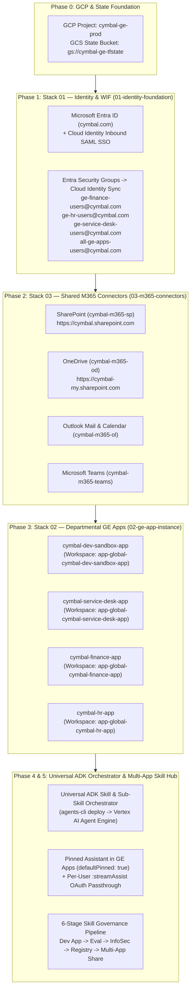

# End-to-End Enterprise Onboarding Guide: **Cymbal (`cymbal.com`)**

This runbook provides the complete, copy-pasteable step-by-step onboarding procedure for **Cymbal** (`cymbal.com`) using the **Gemini Enterprise AppHub & AI Skill Hub** monorepo (`geapphub`).

---

## 1. Cymbal Target Architecture & Onboarding Sequence



### Cymbal Environment Reference Table

| Parameter | Cymbal Production Value |
| :--- | :--- |
| **Customer Name** | `Cymbal` |
| **Corporate Identity Domain** | `cymbal.com` |
| **Initial Entra Tenant Domain** | `cymbal.onmicrosoft.com` |
| **GCP Project ID** | `cymbal-ge-prod` |
| **GCP Region / GE Location** | `us-central1` / `global` |
| **Remote Terraform State Bucket** | `cymbal-ge-tfstate` |
| **Secret Manager M365 Secret** | `cymbal-m365-connector-credentials` |
| **M365 Collection Prefix** | `cymbal-m365` |
| **SharePoint Online URI** | `https://cymbal.sharepoint.com` |
| **OneDrive URI** | `https://cymbal-my.sharepoint.com` |
| **Departmental GE Apps** | `cymbal-dev-sandbox-app`, `cymbal-service-desk-app`, `cymbal-finance-app`, `cymbal-hr-app` |

---

## Phase 0: GCP Project, APIs & Remote Terraform State Bucket

Run these commands once to prepare Cymbal's GCP project (`cymbal-ge-prod`) and create the versioned GCS bucket (`gs://cymbal-ge-tfstate`) used for isolated per-stack and per-app Terraform state locking.

```bash
export CLOUDSDK_METRICS_ENVIRONMENT=geapphub
export GCP_PROJECT_ID="cymbal-ge-prod"
export GCP_REGION="us-central1"
export TF_STATE_BUCKET="cymbal-ge-tfstate"

# 1. Set active project
gcloud config set project "${GCP_PROJECT_ID}"

# 2. Enable required Google Cloud APIs
gcloud services enable \
  discoveryengine.googleapis.com \
  cloudidentity.googleapis.com \
  admin.googleapis.com \
  secretmanager.googleapis.com \
  aiplatform.googleapis.com \
  agentregistry.googleapis.com \
  iam.googleapis.com \
  iamcredentials.googleapis.com \
  sts.googleapis.com \
  storage.googleapis.com \
  bigquery.googleapis.com

# 3. Create the remote Terraform state bucket with Object Versioning enabled
gcloud storage buckets create "gs://${TF_STATE_BUCKET}" \
  --project="${GCP_PROJECT_ID}" \
  --location="${GCP_REGION}" \
  --uniform-bucket-level-access

gcloud storage buckets update "gs://${TF_STATE_BUCKET}" --versioning
```

---

## Phase 1: Identity Foundation (`cymbal.com`) — Stack 01

Stack 01 (`infra/stacks/01-identity-foundation` & `infra/deploy_identity.sh`) configures:
1. **Google Cloud Secret Manager** secret (`cymbal-m365-connector-credentials`) with Entra ID Tenant/Client credentials.
2. **Cloud Identity Inbound SAML 2.0 SSO Profile** for `cymbal.com` redirecting authentication to Microsoft Entra ID.
3. **Entra ID -> Cloud Identity Group & Membership Sync** for `startswith(mailNickname,'ge-')` (`ge-service-desk-users@cymbal.com`, `ge-finance-users@cymbal.com`, `ge-hr-users@cymbal.com`, `all-ge-apps-users@cymbal.com`).

> [!IMPORTANT]
> **Zero-Disk Secret Injection:** Never write `M365_CLIENT_SECRET` to a `.env` file on disk. Export it in your shell session (or pass it through the AppHub Provisioning Studio UI, which injects `TF_VAR_m365_client_secret` in memory and redacts it from all logs).

### Option A: Provision Cymbal Identity via CLI (`deploy_identity.sh`)

```bash
cd /Users/mohanrajs/aops/geapphub/infra

# 1. Export Entra ID credentials in memory (never committed to Git)
export M365_TENANT_ID="<cymbal-entra-tenant-uuid>"
export M365_CLIENT_ID="<cymbal-entra-app-client-uuid>"
export M365_CLIENT_SECRET="<cymbal-entra-app-client-secret>"

# 2. Create Cymbal's identity configuration file
cat > configs/cymbal-identity.env <<'EOF'
GCP_PROJECT_ID="cymbal-ge-prod"
GCP_REGION="us-central1"
GCP_ORG_ID="<cymbal-gcp-org-id>"
GE_LOCATION="global"

CLOUD_IDENTITY_CUSTOMER_ID="customers/<CymbalCustomerID>"
PRIMARY_CUSTOMER_DOMAIN="cymbal.com"
SHARED_IDENTITY_DOMAIN="cymbal.com"
ENTRA_SOURCE_DOMAIN="cymbal.onmicrosoft.com"

TF_STATE_BUCKET="cymbal-ge-tfstate"
TF_STATE_PREFIX="ge-apphub/01-identity-foundation/id-cymbal-com"

M365_SECRET_ID="cymbal-m365-connector-credentials"
ENTRA_GROUP_FILTER="startswith(mailNickname,'ge-')"
ENTRA_TO_APP_GROUP_MAPPINGS="ge-service-desk-users@cymbal.com:cymbal-service-desk-app-users@cymbal.com,ge-finance-users@cymbal.com:cymbal-finance-app-users@cymbal.com,ge-hr-users@cymbal.com:cymbal-hr-app-users@cymbal.com"

ENABLE_CLOUD_IDENTITY_SAML_SSO="true"
SAML_SSO_PROFILE_DISPLAY_NAME="Cymbal Microsoft Entra ID SSO"
ENABLE_WORKFORCE_POOL_OIDC="false"
WORKFORCE_POOL_ID="cymbal-entra-wif-pool"
WORKFORCE_PROVIDER_ID="cymbal-entra-oidc-provider"
EOF

# 3. Run Dry-Run / Plan first (Workspace isolated to id-cymbal-com)
TF_WORKSPACE_OVERRIDE="id-cymbal-com" ./deploy_identity.sh \
  --config configs/cymbal-identity.env \
  --dry-run

# 4. Apply Identity Foundation
TF_WORKSPACE_OVERRIDE="id-cymbal-com" ./deploy_identity.sh \
  --config configs/cymbal-identity.env
```

### Option B: Provision Cymbal Identity via AppHub Admin UI
1. Open the AppHub Portal (`http://localhost:5173`) and sign in as an Admin (`admin@cymbal.com`).
2. In the left sidebar under **Admin Governance**, click **Provisioning Studio**.
3. Select the **Stack 01: Identity & WIF (`01-identity-foundation`)** tab.
4. Enter:
   - **Corporate Domain:** `cymbal.com` (automatically sets Workspace Lock to `id-cymbal-com`)
   - **Cloud Identity Customer ID:** `customers/<CymbalCustomerID>`
   - **Entra Group OData Filter:** `startswith(mailNickname,'ge-')`
   - **Remote GCS State Bucket:** `cymbal-ge-tfstate`
   - **Execution Mode:** `PLAN_AND_WAIT`
5. Click **Run Stack 01: Identity & WIF Plan**, review the generated Terraform plan in the right-hand console, and click **Approve & Apply Plan**.

---

## Phase 2: Shared Microsoft 365 Connectors (`cymbal.sharepoint.com`) — Stack 03

Stack 03 (`infra/stacks/03-m365-connectors` & `infra/deploy_m365.sh`) provisions Cymbal's federated M365 Collections (`cymbal-m365-sp`, `cymbal-m365-od`, `cymbal-m365-ol`, `cymbal-m365-teams`) and enables BAP write actions while enforcing per-user Entra ACLs.

### Option A: Provision Cymbal M365 Connectors via CLI (`deploy_m365.sh`)

```bash
cd /Users/mohanrajs/aops/geapphub/infra

cat > configs/cymbal-m365.env <<'EOF'
GCP_PROJECT_ID="cymbal-ge-prod"
GCP_REGION="us-central1"
GE_LOCATION="global"

TF_STATE_BUCKET="cymbal-ge-tfstate"
TF_STATE_PREFIX="ge-apphub/03-m365-connectors/m365-global-cymbal-m365"

M365_COLLECTION_PREFIX="cymbal-m365"
M365_SECRET_ID="cymbal-m365-connector-credentials"
M365_CONNECTOR_MODE="FEDERATED"
ENABLE_M365_ACTIONS="true"

ENABLE_SHAREPOINT_CONNECTOR="true"
M365_SHAREPOINT_COLLECTION_ID="cymbal-m365-sp"
M365_SHAREPOINT_INSTANCE_URI="https://cymbal.sharepoint.com"
M365_SHAREPOINT_ENTITIES="file,page"

ENABLE_ONEDRIVE_CONNECTOR="true"
M365_ONEDRIVE_COLLECTION_ID="cymbal-m365-od"
M365_ONEDRIVE_INSTANCE_URI="https://cymbal-my.sharepoint.com"
M365_ONEDRIVE_ENTITIES="file"

ENABLE_OUTLOOK_CONNECTOR="true"
M365_OUTLOOK_COLLECTION_ID="cymbal-m365-ol"
M365_OUTLOOK_INSTANCE_URI="https://outlook.office365.com"
M365_OUTLOOK_ENTITIES="mail,mail-attachment,calendar,contact"

ENABLE_TEAMS_CONNECTOR="true"
M365_TEAMS_COLLECTION_ID="cymbal-m365-teams"
M365_TEAMS_INSTANCE_URI="https://teams.microsoft.com"
M365_TEAMS_ENTITIES="channel-message,chat-message"
EOF

# 1. Dry-Run / Plan in isolated workspace m365-global-cymbal-m365
TF_WORKSPACE_OVERRIDE="m365-global-cymbal-m365" ./deploy_m365.sh \
  --config configs/cymbal-m365.env \
  --dry-run

# 2. Apply Cymbal M365 Connectors
TF_WORKSPACE_OVERRIDE="m365-global-cymbal-m365" ./deploy_m365.sh \
  --config configs/cymbal-m365.env
```

### Option B: Provision Cymbal M365 Connectors via AppHub Admin UI
1. In **Provisioning Studio**, select **Stack 03: M365 Connectors (`03-m365-connectors`)**.
2. Set:
   - **Collection Prefix:** `cymbal-m365` (Workspace: `m365-global-cymbal-m365`)
   - **SharePoint Instance URI:** `https://cymbal.sharepoint.com`
   - **OneDrive Instance URI:** `https://cymbal-my.sharepoint.com`
   - Check **SharePoint**, **Outlook**, **Microsoft Teams**, and **OneDrive**.
3. Click **Run Stack 03: M365 Connectors Plan** -> **Approve & Apply Plan**.

---

## Phase 3: Departmental Gemini Enterprise Apps — Stack 02

Each Cymbal business unit gets its own Gemini Enterprise Engine (`02-ge-app-instance`) with **Per-App Terraform Workspace Isolation** (`app-global-<ge_app_id>`), its own Enterprise Knowledge datastore (`<ge_app_id>-enterprise-knowledge-ds-01`), and automatic binding to the shared `cymbal-m365` connectors.

We recommend provisioning **4 GE Apps** for Cymbal:
1. **`cymbal-dev-sandbox-app`**: Isolated Dev/Sandbox GE App where Cymbal prompt engineers author and test new Skills.
2. **`cymbal-service-desk-app`**: Bound to `ge-service-desk-users@cymbal.com`.
3. **`cymbal-finance-app`**: Bound to `ge-finance-users@cymbal.com`.
4. **`cymbal-hr-app`**: Bound to `ge-hr-users@cymbal.com`.

### Provisioning Each Cymbal GE App via CLI (`deploy.sh`)

```bash
cd /Users/mohanrajs/aops/geapphub/infra

# Helper loop to provision all 4 Cymbal GE Apps with isolated Terraform workspaces
for SPEC in \
  "cymbal-dev-sandbox-app|Cymbal AI Skill Dev Sandbox|ge-skill-developers@cymbal.com" \
  "cymbal-service-desk-app|Cymbal Service Desk Assistant|ge-service-desk-users@cymbal.com" \
  "cymbal-finance-app|Cymbal Finance & Accounting Assistant|ge-finance-users@cymbal.com" \
  "cymbal-hr-app|Cymbal People & HR Assistant|ge-hr-users@cymbal.com"; do

  IFS="|" read -r APP_ID APP_NAME ACCESS_GROUP <<< "${SPEC}"
  WORKSPACE_KEY="app-global-${APP_ID}"

  cat > "configs/${APP_ID}.env" <<EOF
GCP_PROJECT_ID="cymbal-ge-prod"
GCP_REGION="us-central1"
GE_LOCATION="global"
GE_APP_ID="${APP_ID}"
GE_APP_DISPLAY_NAME="${APP_NAME}"
GE_COMPANY_NAME="Cymbal"
GE_SOLUTION_TYPE="SOLUTION_TYPE_SEARCH"
GE_SEARCH_TIER="SEARCH_TIER_ENTERPRISE"
GE_ENABLE_LLM_ADDON="true"
GE_INDUSTRY_VERTICAL="GENERIC"
GE_DATA_STORE_ID="${APP_ID}-enterprise-knowledge-ds-01"
GE_DATA_STORE_DISPLAY_NAME="${APP_NAME} Knowledge Store"
GE_BACKING_STORAGE_TYPE="GCS"
GE_GCS_BUCKET_NAME="cymbal-ge-prod-${APP_ID}-docs"
GE_IDENTITY_PROVIDER_TYPE="GSUITE"
GE_CUSTOMER_DOMAIN="cymbal.com"
GE_APP_ACCESS_GROUP="${ACCESS_GROUP}"
GE_APP_GROUP_MEMBERS="admin@cymbal.com"
ENABLE_COMMON_CONNECTORS="true"
COMMON_CONNECTORS_CONFIG="configs/cymbal-m365.env"
TF_STATE_BUCKET="cymbal-ge-tfstate"
TF_STATE_PREFIX="ge-apphub/02-ge-app-instance/${WORKSPACE_KEY}"
EOF

  # 1. Plan in isolated workspace (never overwrites previously created Cymbal apps)
  TF_WORKSPACE_OVERRIDE="${WORKSPACE_KEY}" ./deploy.sh \
    --config "configs/${APP_ID}.env" \
    --dry-run

  # 2. Apply
  TF_WORKSPACE_OVERRIDE="${WORKSPACE_KEY}" ./deploy.sh \
    --config "configs/${APP_ID}.env"
done
```

---

## Phase 4: Deploy & Pin the Universal ADK Skill Orchestrator (`agents-cli`)

Instead of deploying separate microservices per skill, Cymbal deploys **one single Universal Enterprise Skill & Sub-Skill Orchestrator** (`agents/universal_skill_orchestrator/`) to Vertex AI Agent Engine and pins it (`defaultPinned: true`, right alongside **Deep Research**) across all Cymbal GE Apps.

### Step 4.1: Evaluate & Deploy to Vertex AI Agent Runtime via `agents-cli`

```bash
cd /Users/mohanrajs/aops/geapphub/agents/universal_skill_orchestrator
export CLOUDSDK_METRICS_ENVIRONMENT=geapphub
export GOOGLE_CLOUD_PROJECT="cymbal-ge-prod"
export GOOGLE_CLOUD_LOCATION="us-central1"

# 1. Install dependencies & smoke test locally
agents-cli install
agents-cli run "Run skill customer-escalation-resolver for Cymbal P1 ticket" --start-server

# 2. Run behavioral & tool-trajectory evaluation
agents-cli eval run tests/eval/eval_config.json

# 3. Deploy to Vertex AI Agent Runtime (writes remote_agent_engine_id to deployment_metadata.json)
agents-cli deploy \
  --project cymbal-ge-prod \
  --region us-central1 \
  --no-wait

# 4. Check deployment status until SUCCEEDED
agents-cli deploy --status
```

### Step 4.2: Register OAuth Passthrough & Pin Orchestrator in Cymbal's GE Apps

You can publish and pin the orchestrator from **Provisioning Studio -> Pin Orchestrator (`agents-cli publish`)** in the UI, or via the CLI for each Cymbal GE App:

```bash
cd /Users/mohanrajs/aops/geapphub/agents/universal_skill_orchestrator

for APP_ID in cymbal-service-desk-app cymbal-finance-app cymbal-hr-app; do
  agents-cli publish gemini-enterprise \
    --project-id cymbal-ge-prod \
    --app-id "${APP_ID}" \
    --app-location global \
    --display-name "Cymbal Enterprise Skill Orchestrator" \
    --description "Executes governed Cymbal Parent Skills and Sub-Skills using your Cymbal M365 & GE identity." \
    --authorization-id "projects/cymbal-ge-prod/locations/global/authorizations/cymbal-user-oauth-passthrough" \
    --mode adk
done
```

Then in **AppHub -> Provisioning Studio -> Pin Orchestrator (`agents-cli publish`)**, select `cymbal-service-desk-app` (and `cymbal-finance-app`, `cymbal-hr-app`) and click **Publish & Pin Orchestrator in Gemini Enterprise**. This executes the Discovery Engine `v1alpha` `PATCH` setting `defaultPinned: true` and syncing Cymbal's approved skills as clickable `starterPrompts`.

---

## Phase 5: Multi-App AI Skill Hub & Sub-Skill Governance for Cymbal

### Step 5.1: Seed Atomic Sub-Skills & Composite Parent Skills
1. Start the AppHub Backend, Skill Workflow Microservice, and Frontend (see Phase 6 below), or call:
   ```bash
   curl -X POST http://localhost:8080/api/v1/skills/seed-catalog \
     -H "X-Goog-Authenticated-User-Email: admin@cymbal.com"
   ```
2. This seeds:
   - **Atomic Sub-Skill 1:** `skills_catalog/subskills/m365-outlook-triage/SKILL.md` (triages Cymbal Outlook escalation threads & calendar SLA windows).
   - **Atomic Sub-Skill 2:** `skills_catalog/subskills/sharepoint-policy-lookup/SKILL.md` (queries `https://cymbal.sharepoint.com` for SLA credit policies).
   - **Composite Parent Skill:** `skills_catalog/composite_skills/customer-escalation-resolver/SKILL.md` (`sub_skills: [m365-outlook-triage, sharepoint-policy-lookup]`).

### Step 5.2: Authoring & Promoting New Cymbal Skills Across Apps
1. **Create in Dev Sandbox (`cymbal-dev-sandbox-app`):** Cymbal skill creators author a new skill in `cymbal-dev-sandbox-app` and propose sharing it with:
   - `group:ge-finance-users@cymbal.com` (routes to `cymbal-finance-app`)
   - `group:ge-hr-users@cymbal.com` (routes to `cymbal-hr-app`)
   - or `group:all-ge-apps-users@cymbal.com` (**Global** distribution to all Cymbal GE Apps).
2. **Automated 6-Stage Governance Pipeline:**
   - **Stage 1 (Templatization & Token Optimization):** Replaces `cymbal-dev-sandbox-app` with `{{engine_id}}`, extracts `sub_skills`, and scores token efficiency.
   - **Stage 2 (Multi-App Readiness Matrix):** Verifies that each target Cymbal GE App (`cymbal-finance-app`, `cymbal-hr-app`, `cymbal-service-desk-app`) has the required `cymbal-m365-*` datastores attached.
   - **Stage 3 (InfoSec ADK Scan):** Scans for prompt injection, PII exfiltration, and unapproved external URLs.
   - **Stage 4 (InfoSec Human Approval):** Cymbal InfoSec reviewer clicks **Approve & Publish** in **Skill Governance**.
   - **Stage 5 & 6 (Registry Publish & Multi-App Share):** Publishes the parameterized `SKILL.md` to GCP Agent Registry (`urn:skill:projects-cymbal-ge-prod:...`), renders it per target Cymbal GE App, and automatically updates `starterPrompts` on Cymbal's Pinned Skill Orchestrator Agent.

---

## Phase 6: Running & Verifying the Cymbal AppHub Portal

### Step 6.1: Configure & Start the Services for Cymbal

```bash
cd /Users/mohanrajs/aops/geapphub

# 1. Start AppHub Catalog & Provisioning Backend (Port 8080)
cd /Users/mohanrajs/aops/geapphub/backend
CLOUDSDK_METRICS_ENVIRONMENT=geapphub \
GCP_PROJECT_ID="cymbal-ge-prod" \
GCP_LOCATION="global" \
WORKSPACE_DOMAIN="cymbal.com" \
USE_MOCK_DATA="false" \
../.venv/bin/uvicorn app.main:app --host 0.0.0.0 --port 8080

# 2. Start Skill Governance & Orchestrator Microservice (Port 8081)
cd /Users/mohanrajs/aops/geapphub/backend
CLOUDSDK_METRICS_ENVIRONMENT=geapphub \
GCP_PROJECT_ID="cymbal-ge-prod" \
GCP_LOCATION="global" \
WORKSPACE_DOMAIN="cymbal.com" \
USE_MOCK_DATA="false" \
../.venv/bin/uvicorn skill_workflow_service.main:app --host 0.0.0.0 --port 8081

# 3. Start Vite React Frontend (Port 5173)
cd /Users/mohanrajs/aops/geapphub/frontend
npm run dev -- --host 0.0.0.0 --port 5173
```

### Step 6.2: Post-Onboarding Verification Checklist for Cymbal (`cymbal.com`)

- [ ] **Identity & SAML SSO:** Sign in as `alice@cymbal.com` (member of `ge-finance-users@cymbal.com`) and verify SSO redirects to Cymbal's Microsoft Entra ID login and filters the **My GE Apps** catalog to `cymbal-finance-app`.
- [ ] **Per-App Terraform Isolation:** Open **Provisioning Studio**, create a new `cymbal-legal-app`, and verify its workspace is locked to `app-global-cymbal-legal-app` without modifying `cymbal-finance-app`, `cymbal-hr-app`, or `cymbal-service-desk-app`.
- [ ] **Composite Skill & Sub-Skill Orchestration:** Open **AI Skill Hub**, click **Run via Universal Orchestrator** on **Customer Escalation Resolver**, and verify that `Step 1: m365-outlook-triage` and `Step 2: sharepoint-policy-lookup` execute sequentially via `:streamAssist` under the calling `@cymbal.com` user's identity.
- [ ] **Pinned Assistant in Gemini Enterprise:** Launch `cymbal-service-desk-app` and confirm **Cymbal Enterprise Skill Orchestrator** is pinned in the left navigation bar (`defaultPinned: true`) alongside **Deep Research** with clickable skill starter prompts.
