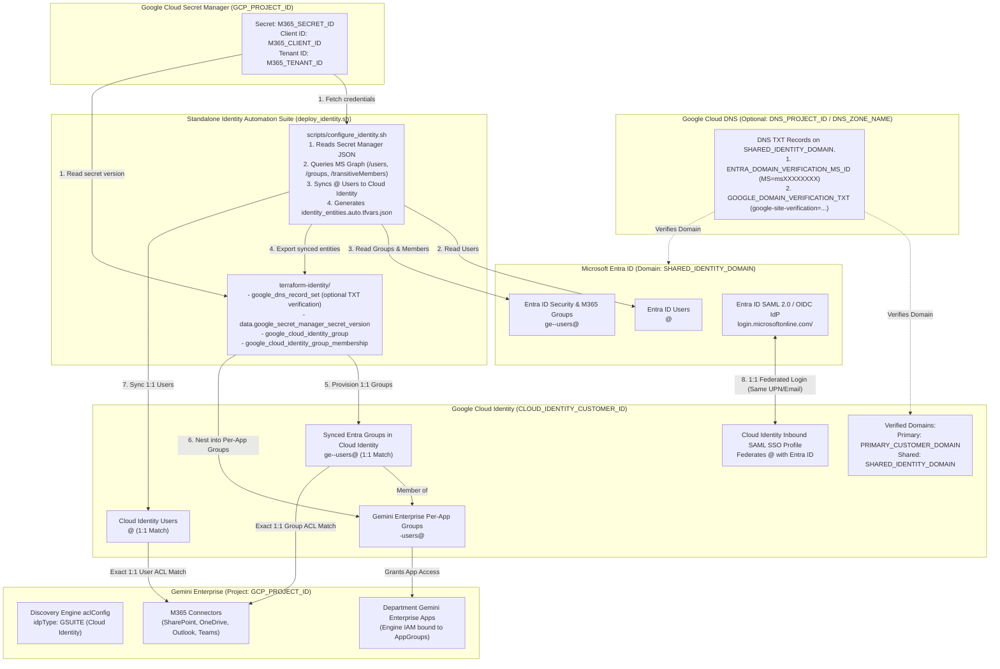
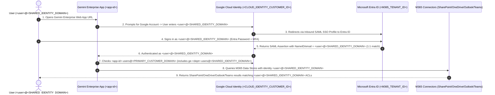

# Architecture & Step-by-Step Setup: Shared Corporate Domain Across Microsoft Entra ID & Google Cloud Identity

> [!TIP]
> **Configuration-Driven Architecture (`configs/identity.env`):**
> All domain names, tenant/customer IDs, Secret Manager paths, and DNS zones in this design are parameterized via [`configs/identity.env.example`](../configs/identity.env.example):
> - **Cloud DNS Zone (Optional):** Project `${DNS_PROJECT_ID}` $\rightarrow$ Managed Zone `${DNS_ZONE_NAME}` (`${SHARED_IDENTITY_DOMAIN}.`) when `MANAGE_DNS_VERIFICATION_RECORD="true"`.
> - **Microsoft Entra ID (`${M365_TENANT_ID}`):** `${SHARED_IDENTITY_DOMAIN}` verified as the corporate domain for users and security groups.
> - **Entra App Registration (`${M365_CLIENT_ID}`):** OAuth 2.0 credentials (`{"tenant_id","client_id","client_secret"}`) stored in Google Cloud Secret Manager at `projects/${GCP_PROJECT_ID}/secrets/${M365_SECRET_ID}`.
> - **Google Cloud Identity (`${CLOUD_IDENTITY_CUSTOMER_ID}`):** Primary domain `${PRIMARY_CUSTOMER_DOMAIN}` (and optional secondary domain `${SHARED_IDENTITY_DOMAIN}` if distinct) enabling 1:1 identity and ACL matching across Entra ID, Cloud Identity, and Gemini Enterprise M365 Connectors.

---

## 1. Configuration Parameter Reference (`configs/identity.env`)

| Parameter | Description | Example Value |
| :--- | :--- | :--- |
| `GCP_PROJECT_ID` | Google Cloud Project hosting Gemini Enterprise & Secret Manager | `customer-ge-prod-001` |
| `CLOUD_IDENTITY_CUSTOMER_ID` | Google Cloud Identity Customer ID (`admin.google.com`) | `customers/C01234567` |
| `PRIMARY_CUSTOMER_DOMAIN` | Primary domain of the Google Cloud Identity account | `example.com` |
| `SHARED_IDENTITY_DOMAIN` | Verified corporate domain shared across Entra ID & Cloud Identity | `example.com` |
| `M365_SECRET_ID` | Secret Manager secret storing `{"tenant_id","client_id","client_secret"}` | `m365-connector-credentials` |
| `M365_TENANT_ID` | Microsoft Entra ID Directory (tenant) ID *(exported via environment variable)* | `export M365_TENANT_ID="..."` |
| `M365_CLIENT_ID` | Microsoft Entra ID OAuth 2.0 Application (client) ID *(exported via environment variable)* | `export M365_CLIENT_ID="..."` |
| `M365_CLIENT_SECRET` | Microsoft Entra ID OAuth 2.0 Client Secret *(exported via environment variable)* | `export M365_CLIENT_SECRET="..."` |
| `ENTRA_TO_APP_GROUP_MAPPINGS` | 1:1 mapping from synced Entra groups to Gemini Enterprise per-app groups | `ge-finance-users@example.com:finance-app-01-users@example.com` |

### Environment Variable Setup & Pre-Flight Validation
Before running `./deploy_m365.sh` or `./deploy_identity.sh`, export the M365 credentials in your shell and validate them:
```bash
export M365_TENANT_ID="<your-entra-tenant-id>"
export M365_CLIENT_ID="<your-entra-app-client-id>"
export M365_CLIENT_SECRET="<your-entra-app-client-secret>"

# 1. Verify environment variables are non-empty
for var in M365_TENANT_ID M365_CLIENT_ID M365_CLIENT_SECRET; do
  [[ -n "${!var:-}" ]] && echo "[OK] ${var} is set" || { echo "[ERROR] ${var} is NOT set"; exit 1; }
done

# 2. Run pre-flight dry-run validation before applying changes
./deploy_identity.sh --config configs/identity.env --dry-run
```

---

## 2. End-to-End Architecture Diagram



---

## 3. Authentication & ACL Flow



---

## 4. Portal Prerequisites Checklist

### Part A: Google Admin Console (`admin.google.com`) — Verify `SHARED_IDENTITY_DOMAIN`
*(Skip if `SHARED_IDENTITY_DOMAIN` is already verified as your Primary or Secondary domain in Google Cloud Identity).*

1. Sign in to [Google Admin Console (`admin.google.com`)](https://admin.google.com) as a Super Admin (`admin@<PRIMARY_CUSTOMER_DOMAIN>`).
2. Navigate to **Account $\rightarrow$ Domains $\rightarrow$ Manage domains**.
3. Click **Add a domain**:
   * **Domain name:** `<SHARED_IDENTITY_DOMAIN>`
   * **Domain type:** Select **Secondary domain** (so users and groups can have `@<SHARED_IDENTITY_DOMAIN>` as their primary address).
4. Click **Add domain & start verification** $\rightarrow$ choose **TXT verification record** and copy the `google-site-verification=...` string.
5. Add the TXT record to your DNS provider (or set `MANAGE_DNS_VERIFICATION_RECORD="true"`, `DNS_PROJECT_ID`, `DNS_ZONE_NAME`, and `GOOGLE_DOMAIN_VERIFICATION_TXT` in `configs/identity.env` to manage it via `terraform-identity/`), then click **Verify** in Google Admin Console.

---

### Part B: Microsoft Entra Admin Portal (`entra.microsoft.com`) — Grant Graph Permissions & Configure SAML SSO

1. **Grant Microsoft Graph Application Permissions on the OAuth App Registration (`M365_CLIENT_ID`):**
   * Go to **Identity $\rightarrow$ Applications $\rightarrow$ App registrations $\rightarrow$ All applications** and select your connector App Registration (`Client ID: <M365_CLIENT_ID>`).
   * In the left menu, click **API permissions $\rightarrow$ + Add a permission $\rightarrow$ Microsoft Graph $\rightarrow$ Application permissions**.
   * Check the following **Application** permissions (in addition to your M365 connector permissions):
     * `User.Read.All` *(Read all users' full profiles — or `User.ReadWrite.All` if enabling `ENTRA_BULK_UPDATE_UPN_DOMAIN="true"`)*
     * `Group.Read.All` *(Read all groups — or `Group.ReadWrite.All` if enabling `PROVISION_CLEAN_ENTRA_APP_GROUPS="true"`)*
     * `GroupMember.Read.All` *(Read all group memberships)*
     * `Domain.Read.All` *(Optional — for domain verification checks)*
   * Click **Add permissions**, then click **"Grant admin consent for [Your Organization]"** and confirm **Yes** until all status badges show a green checkmark.

2. **Configure Inbound SAML 2.0 SSO via Entra Enterprise Gallery App:**
   * Go to **Identity $\rightarrow$ Applications $\rightarrow$ Enterprise applications $\rightarrow$ + New application** and search for **"Google Cloud / G Suite Connector by Microsoft"**.
   * After running `./deploy_identity.sh --config configs/identity.env`, copy the output `SAML SP Entity ID` and `SAML SP ACS (Reply) URL` into the gallery app's **Single sign-on $\rightarrow$ SAML** configuration:
     * **Identifier (Entity ID):** `https://accounts.google.com/samlrp/<profile_id>`
     * **Reply URL (ACS URL):** `https://accounts.google.com/samlrp/<profile_id>/acs`
     * **Sign on URL:** `https://www.google.com/a/<SHARED_IDENTITY_DOMAIN>/ServiceLogin?continue=https://vertexaisearch.cloud.google.com`
   * Download the **Certificate (Base64)** (`.cer` file) and either set `SAML_IDP_CERT_FILE="/path/to/cert.cer"` in `configs/identity.env` and re-run `./deploy_identity.sh --config configs/identity.env`, or upload it in **Google Admin Console $\rightarrow$ Security $\rightarrow$ Authentication $\rightarrow$ SSO with third-party IdP**.

3. **Optional — Continuous User Auto-Provisioning (SCIM 2.0):**
   * Inside the same **"Google Cloud / G Suite Connector by Microsoft"** Enterprise Application, select **Provisioning**, set **Provisioning Mode** to **Automatic**, click **Authorize** (sign in with `admin@<PRIMARY_CUSTOMER_DOMAIN>`), and start provisioning. Because both sides use `@<SHARED_IDENTITY_DOMAIN>`, the default `userPrincipalName` mapping works out-of-the-box without custom expressions.
